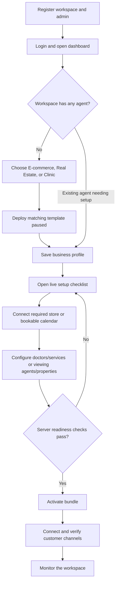

# AI Workforce: current project flow

Last checked: 11 October 2026. This guide describes what the current code does,
how a user moves through it, and where the implementation still differs from a
fully self-serve production SaaS. It is based on the web routes, API routes,
services and Prisma models in this repository. A code path or template label
does not by itself prove that a live provider connection has been tested.

## 1. What the product is today

AI Workforce is a multi-tenant business operations app. A registered business
gets a workspace, selects a starting industry bundle, saves business details,
and connects available services. The workspace currently offers e-commerce
support and store data, real-estate lead qualification and appointment workflows,
and clinic appointment workflows. A human can review risky actions and take
over customer conversations.

The implementation is a working product prototype with real database-backed
features and several provider integrations. It should not yet be described as a
fully automated, production-ready SaaS: provider setup and live delivery still
depend on platform configuration, some flows require manual setup, and the
passing the onboarding checklist does not replace live launch acceptance.

## 2. System map

```text
Browser (Next.js dashboard)
  |  /api/proxy/* (forwards authenticated requests)
  v
Express API (/api/v1/*)
  |-- Auth, tenant isolation, roles and permissions
  |-- Domain services and provider clients
  |-- PostgreSQL via Prisma
  |-- Redis/BullMQ for general WhatsApp message work (when available)
  |-- Database-backed niche dispatch worker for clinic/real-estate automation
  |-- Socket.IO events for selected live dashboard updates
  v
Shopify / WooCommerce / Meta WhatsApp / Google Calendar / Vapi / Gemini
```

The API starts the autonomy scheduler and niche automation timer when the API
process starts. The normal inbound support agent uses BullMQ when Redis is
available and has an in-process asynchronous fallback. Clinic and real-estate
WhatsApp automation uses persisted database dispatch rows, processed by the API
worker. The health endpoint checks both PostgreSQL and Redis, so it may report
unhealthy if Redis is down even when read-only API routes and fallback work.

## 3. New customer journey: what happens now



1. **Register.** `POST /api/v1/auth/register` creates a tenant and admin,
   seeds tenant roles/permissions, records an audit event, and returns an auth
   token. Login verifies the password, resolves roles/permissions and records
   `user_login`. There is no evidence in this flow of email verification or
   enforced billing before workspace creation.
2. **Choose an initial bundle.** A new workspace with no agents is sent to
   `/dashboard/onboarding`. The screen offers E-commerce, Real Estate and
   Clinic. Choosing one deploys its seeded workflow and creates an agent with
   `activate: false`, so the initial agent is paused.
3. **Save business details.** The guided flow opens Business setup. The profile
   stores market/country, timezone, currency and business information used by
   calendar availability, booking and qualification. Calendar OAuth is also
   managed from this area. The profile API is tenant-isolated and writes are
   admin-only.
4. **Connect services.** Integrations currently has Shopify, WooCommerce and
   WhatsApp. Google Calendar is in Business setup. Store owner authorization is
   used for Shopify/WooCommerce and Meta Embedded Signup for WhatsApp; the SaaS
   platform's provider configuration is still required. Credentials are stored
   encrypted per tenant. Each workspace can connect one commerce platform at a
   time; the API rejects connecting Shopify and WooCommerce together.
5. **Configure the business workflow.** Clinic admins add doctors and services.
   Real-estate admins add viewing agents, properties and leads. Those records
   power availability, matching and appointment flows. Business hours and
   timezone must be saved before checking calendar availability.
6. **Activate and operate.** The onboarding checklist reads current workspace
   state and shows required setup steps. Commerce requires a saved business
   profile and Shopify or WooCommerce; healthcare and real estate require a
   matching profile, a writable selected Google Calendar, and minimum workflow
   records. The activation API checks the same requirements, so a UI bypass
   cannot start an unconfigured bundle. WhatsApp is a separate channel: a saved
   connection without a recent real delivery test is marked `needs_test` and
   customer replies stay paused. **Still verify provider delivery and calling
   with real accounts before claiming production readiness.**
7. **Enable channels and operate.** Healthcare/real-estate channel automation is
   configured separately under Automation & inbox. WhatsApp, voice and reminders
   default off. Enabling them checks for the relevant credentials/profile and,
   for reminders, a valid approved WhatsApp template. The customer flow includes
   consent, booking/qualification steps, STOP and HUMAN handling. The admin can
   monitor conversations and dispatch status, reply within the WhatsApp service
   window, pause/resume a session and manage bookings.

### Readiness and known limitations

`GET /tenants/:tenantId/onboarding-status` now reports current required steps and
is used by both onboarding navigation and activation guards. It verifies saved
commerce credentials and, for appointment bundles, checks selected Google
Calendar booking access plus the minimum active workflow records. WhatsApp is
shown separately as optional or needing a delivery test. Saved credentials do
not guarantee they remain valid; provider requests and real delivery must still
be monitored. Voice setup is not an activation prerequisite in this checklist.

## 4. E-commerce flow

1. Admin connects Shopify with the OAuth install flow, which validates callback
   HMAC and short-lived tenant-bound state, exchanges the code, checks scopes and
   saves the credential. WooCommerce uses its store authorization callback,
   checks the returned key and verifies the store connection. Current WooCommerce
   setup is read-only.
2. The app can answer supported stock questions using a connected store's live
   product/inventory data, and the support inbox can use this lookup before
   falling back to FAQ, knowledge retrieval and the support model.
3. Shopify writes have a separate workspace switch and are additionally
   constrained by granted scopes. Refunds/cancellations pass through an approval
   request; approval is bound to the tenant, agent, action and payload before
   execution. Disabling store writes prevents those live write actions.
4. The Overview assistant reads live exact-SKU inventory from Shopify or
   WooCommerce. Shopify additionally supports unique product titles in quotes
   (including variants without SKUs), catalog prices, exact order status,
   date-filtered order-value summaries and bounded low-stock scans. Order and
   financial reads enforce the corresponding workspace permissions. Missing
   scope, ambiguous data and incomplete reports have explicit responses.
   Workspace counts still come from the database; Gemini can select a validated
   metric intent but does not write the factual answer. This is read only, with
   documented reporting limits, not arbitrary store access. See
   [store assistant readiness](docs/STORE_ASSISTANT_READINESS.md) for supported
   prompts, definitions, scope rollout, live evidence and remaining acceptance.

The E-commerce template description mentions a voice callback provider, but
there is no implemented e-commerce callback workflow in the niche automation
conversation engine. Do not treat that template text as a ready-to-use feature.

## 5. Clinic and Real Estate flows

### Shared setup

The admin creates clinic staff/resources or real-estate viewing agents, then
configures business hours and Google Calendar. Availability checks combine the
selected resource's schedule and calendar events. A booking reserves a slot in
the app and synchronizes a private event to Google Calendar; pending sync,
confirmed, cancellation and review-required states are shown separately. These
screens also allow staff to retry synchronization or cancel a booking.

Manual appointment booking in the dashboard and customer automation are
separate paths. Saving a doctor or property does not start WhatsApp automation.
The automation configuration must be explicitly saved with its channels enabled.

### Clinic

The customer reception flow asks for consent and a name, presents active doctors
and services, checks available times and asks the patient to confirm before
booking. It is a scheduling assistant, not a medical assistant. Certain urgent
or clinical messages are handed to staff with emergency guidance. The current
guardrail detects a limited set of terms; it is not a substitute for a reviewed
clinical safety process.

### Real estate

The lead flow asks structured questions about buying/renting, location, property
type, budget, timeline and funding. It stores a workspace lead and matches saved
listings before offering a viewing workflow. The dashboard's lead qualification
is rules-based; it is not an AI prediction or a connected external CRM pipeline.

### Phone calling

Vapi is the implemented provider for niche voice callbacks/assistant tool turns.
The admin setup currently requires provider-side configuration and credentials;
the user must opt in/request a callback. Voice is not automatically available
just because the template includes a voice node. Retell appears in a seeded
E-commerce template description, but this repository does not implement the
corresponding niche call workflow. Telephone calling is distinct from WhatsApp
Calling, which is not implemented here.

## 6. WhatsApp inbound and reply path

```text
Meta webhook
  -> raw body signature verification
  -> match phone number ID to one active workspace credential
  -> persist/deduplicate inbound event
  -> niche automation dispatch OR general support queue
  -> process customer turn, consent/STOP/HUMAN and business rules
  -> send through that workspace's WhatsApp credentials
  -> record Meta acceptance/delivery status when available
```

Meta Embedded Signup stores an authorized workspace credential. The UI reports
`Connected · Test required`; stored credentials alone are not treated as proof
that a number is registered or messages can be delivered. General support
messages are handled by the support agent path; clinic and real-estate messages
are persisted and processed by the niche workflow path when that automation is
configured. Niche delivery receipts update dispatch status. Failed or uncertain
send outcomes need review; an uncertain general-support send is not blindly
retried to avoid a duplicate customer reply.

The WhatsApp setup still requires platform-side Meta app configuration, a public
HTTPS webhook, eligible business assets, number registration and an actual
inbound/outbound verification. Disconnecting removes this workspace's credential;
it deliberately does not unsubscribe the entire shared WABA from the platform
webhook.

## 7. Human review, security and audit

- Authenticated API requests carry a user/tenant identity. Tenant routes apply
  tenant isolation; sensitive endpoints also apply role/permission checks.
- Integration credentials are encrypted before database storage. API status
  responses should return connection metadata rather than secret tokens.
- Public provider webhooks use their respective signature/authentication and
  account ownership checks. User-facing records and actions are tenant-scoped.
- Risky Shopify refund/cancel actions are paused for an authorized human review.
  The approval is consumed atomically and the executed payload must match what
  was approved. Other business actions have their own rules; HITL is not a
  universal wrapper around every possible external write.
- Audit logs capture key account, setup, approval and workflow events. Socket.IO
  sends selected events such as approvals and inbound message updates to the
  relevant tenant dashboard.
- Per-conversation human handoff pauses automated replies. This does not yet
  provide live phone-call transfer to a staff member.

## 8. Main screens and their purpose

| Screen | Current purpose |
| --- | --- |
| `/dashboard/onboarding` | Choose the first industry bundle for a new workspace. |
| `/dashboard` | Workspace counts, recent activity, agent pause/resume and read-only assistant. |
| `/dashboard/integrations` | Connect one commerce store and WhatsApp; inspect status and store write permission. |
| `/dashboard/settings/business` | Save business profile/hours and connect/select Google Calendar; check availability. |
| `/dashboard/settings/whatsapp` | Start Meta Embedded Signup and inspect connection/testing status. |
| `/dashboard/healthcare` | Doctors, services, appointments, automation and inbox. |
| `/dashboard/real-estate` | Viewing agents, properties, leads, appointments, automation and inbox. |
| `/dashboard/approvals` | Review pending human-gated actions supported by the approval UI. |
| `/dashboard/support-inbox` | General support conversations, per-customer drafts, latest/older message history, staff replies and AI pause/resume. |
| `/dashboard/templates` | Browse and deploy additional seeded bundles. |
| `/dashboard/voice-logs` | Inspect stored voice sessions where a configured provider has sent events. |

Other backend modules expose sales, marketing, finance, operations, task and
workflow APIs. A service or route existing in the API does not mean there is a
complete, polished customer-facing workflow for it in the current dashboard.

## 9. Current limits and work needed for a professional SaaS flow

1. The persistent prerequisite checklist and server-side activation guard are
   implemented. Run the complete new-customer browser journey for each bundle;
   saved credentials and passing checks do not prove real provider delivery.
2. New bundles start paused. Verify activation, adding/replacing bundles and
   pause behavior across the dashboard and background channel workers.
3. Finish and verify provider setup in real Meta, Shopify, WooCommerce, Google
   and Vapi accounts. Local automated tests do not establish live delivery.
4. The guided WhatsApp test distinguishes inbound receipt, provider acceptance
   and delivery receipt. Execute it against an actual Meta number; real delivery
   has not yet been established by the mocked tests.
5. Build a simple managed voice onboarding path, with provider/number readiness,
   explicit test-call consent, costs/limits and call-result handling. Keep
   advanced bring-your-own-provider settings separate.
6. Enforce activation and pause consistently across dashboard controls,
   channel automation and background workers. Today agent `isActive` and niche
   channel flags are separate controls.
7. Complete localized customer flows (including Urdu/Arabic where targeted),
   real CRM handoff, stronger operational monitoring and launch/billing checks.

The paid-pilot checklist and commerce-specific limits are maintained in
[STORE_ASSISTANT_READINESS.md](docs/STORE_ASSISTANT_READINESS.md). Internal credit
tracking does not yet constitute a self-serve subscription payment lifecycle.

## 10. Useful code entry points

- Web onboarding and workspace views: `apps/web/app/(protected)/dashboard/` and
  `apps/web/components/workforce/`.
- API composition and server startup: `apps/api/src/app.ts` and
  `apps/api/src/index.ts`.
- Registration/authentication: `apps/api/src/controllers/authController.ts`
  and `apps/api/src/services/authService.ts`.
- Bundle seeding/deployment: `apps/api/src/services/templateService.ts`.
- Provider setup: `apps/api/src/routes/shopifyOAuthRoutes.ts`,
  `apps/api/src/routes/woocommerceRoutes.ts`,
  `apps/api/src/routes/whatsappOnboardingRoutes.ts`,
  `apps/api/src/services/googleCalendarService.ts`.
- Clinic/real-estate data and bookings:
  `apps/api/src/services/nicheWorkflowService.ts`.
- Customer automation and background dispatch:
  `apps/api/src/services/nicheConversationService.ts`,
  `apps/api/src/services/nicheAutomationWorker.ts` and
  `apps/api/src/services/nicheProviders.ts`.
- General WhatsApp support:
  `apps/api/src/services/supportAgentService.ts` and
  `apps/api/src/services/whatsappService.ts`.
- Approval-protected store actions: `apps/api/src/services/actionExecutorService.ts`
  and `apps/api/src/services/approvalService.ts`.

For the detailed WhatsApp/voice verification state and recent connection hardening,
see [the readiness audit](docs/WHATSAPP_VOICE_READINESS_AUDIT.md) and
[implementation progress](docs/WHATSAPP_CONNECTION_PROGRESS.md).

## 11. Finalization update: subscriptions, store questions, and daily reports

The following implementation and local database work was completed on 11
October 2026. Code readiness, automated tests, and live provider delivery are
separate claims; no real provider delivery is claimed without a live receipt.

- **Store assistant:** bundle and agent questions use current tenant records.
  Store lookups remain tenant-bound and deterministic; a language model may
  classify a question but cannot supply inventory or sales figures. Supported
  questions are bounded to current exact-SKU stock, exact product stock/price,
  exact order status, low-stock scans, and defined Shopify order-period reports.
  WooCommerce currently supports exact-SKU stock only. This is not unrestricted
  access to every store policy, customer record, historical metric or report.
- **Customer-facing answers:** support can use verified product and stock
  facts. Customer order, sales or unsupported requests go to staff because the
  customer is not verified as the store owner. Merchant financial reports are
  admin-only and require `finance:read` for chat access.
- **Agent controls:** channel workers check the matching active workspace agent
  and subscription before new automated work. Pause remains available after a
  billing lapse. Staff replies, STOP and customer-requested handoff preserve
  their safety path.
- **Subscriptions:** Stripe checkout, portal and signed webhook flows existed
  already. This pass validates checkout return origins, expires an open
  checkout when a different plan is chosen, refreshes dashboard billing
  status, and deducts one included credit per workforce question before any
  provider read when billing enforcement is enabled. Insufficient balance
  returns a clear billing error; local development remains unmetered. The
  dashboard states the per-question cost. Real
  purchase acceptance still needs configured Stripe test prices,
  keys and webhook delivery; unit tests do not establish a live payment.
- **Daily store reports:** `/dashboard/reports` lets workspace admins preview
  Shopify order-period summaries, set the report recipient and local delivery
  time, record recipient consent, and schedule a daily WhatsApp template.
  Reports persist uniquely per workspace and date, use the saved IANA business
  timezone, validate Shopify order access and an approved seven-parameter Meta
  Utility template, track delivery receipts, catch up missed scheduled dates
  after restarts, and stop automatic retry when provider acceptance is unknown.
  The seven template values are period, order count, units, current order
  value (includes unpaid orders), value on paid orders, unfulfilled count and
  top products. The preview also shows both value totals and the excluded/test
  counts. It includes unpaid orders in current
  order value and is not accounting net sales, cash received or profit. Live
  sending requires an existing Shopify/Meta setup, an approved template and
  recipient consent; no report message was sent during implementation.
- **Local verification:** migration `20261011000000_store_daily_reports` is
  applied and all 14 local Prisma migrations are current. The focused API run
  passed 145 tests across store reports, scheduler, Meta template validation,
  merchant questions, commerce, metrics, subscriptions, healthcare automation
  and support inbox. API and web type checks passed before the final build gate.

**Release acceptance still to do:** complete the full test/build run; verify
two-workspace browser onboarding and isolation; test non-empty Shopify fixtures;
complete Stripe test purchase, cancellation and payment-failure flow; run a
disposable-calendar appointment create/cancel cycle; and, when WhatsApp is
connected, confirm a real report delivery receipt. WhatsApp connection setup
and deployment/hosting are outside this finalization scope. Voice provider
acceptance, WooCommerce reporting parity, broader analytics and localized
onboarding remain separate work.
