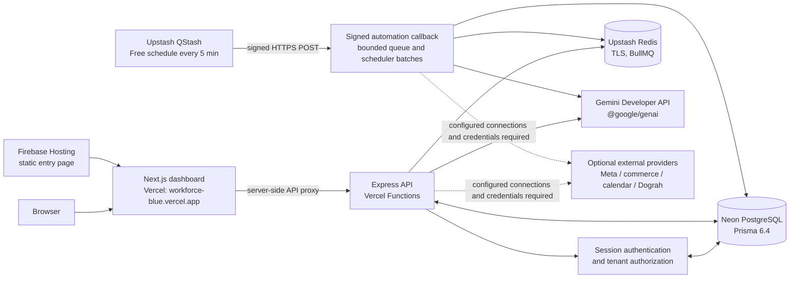

# AI Workforce — Project Summary & Architecture Notes

**Purpose:** Architecture summary for the live AI Workforce prototype, including its Gemini and Google Cloud AI integration scope.

**Reviewed:** 21 October 2026

**Source release:** Dograh voice cutover pending a new production release; deployed release details remain in the live verification snapshot below.

## Project summary

AI Workforce is a multi-tenant business operations platform. Users manage a workspace in a Next.js dashboard, ask an AI assistant questions, and configure operational workflows. The Express API authenticates requests, enforces tenant boundaries, retrieves business data through permission-checked services, stores application state, and coordinates background work. Google Gemini is called server-side for selected natural-language tasks, support responses, and semantic embeddings.

The verified live prototype uses Vercel for the Next.js frontend and Express API, Neon PostgreSQL for persistent data, Upstash Redis for queues and coordination, and Upstash QStash for signed periodic automation callbacks. A small Firebase Hosting page provides an additional public entry point to the dashboard. The live service uses free plans with finite quotas; payment and automatic paid upgrades remain disabled.

## Architecture

### Runtime components

| Component | Responsibility | Live configuration |
| --- | --- | --- |
| `apps/web` | Next.js dashboard, session-aware UI, and server-side API proxy | Vercel project `workforce`; public URL `https://workforce-blue.vercel.app`; server-only `API_INTERNAL_URL` points to the API. |
| `apps/api` | Express routes, authentication, tenant checks, Gemini calls, integrations, and queue producers | Vercel project `ai-workforce-api`; public URL `https://ai-workforce-api-phi.vercel.app`; Node.js 22.x. |
| PostgreSQL | Users, tenants, workspace data, conversations, workflows, and durable application records | Neon Free; Prisma 6.4; 15 migrations applied. Runtime uses the pooled TLS URL; migrations select a direct/unpooled URL when configured. |
| Redis | BullMQ queue data, leases, and callback completion marker | Upstash Redis Free over verified TLS; eviction disabled and paid auto-upgrade disabled. |
| Scheduled automation | Periodic processing without a continuously running worker | Upstash QStash Free calls the signed API callback every five minutes. |
| Firebase Hosting | Static entry page linking to the dashboard | `https://gen-lang-client-0445651739.web.app`; the Next.js application itself is served by Vercel. |

The API is configured for HTTP-only Vercel execution with continuous BullMQ consumers disabled. A QStash callback starts a bounded temporary consumer and bounded scheduler batches. A Redis lease prevents overlapping cycles, and callback signatures are verified against the raw request body and canonical API URL. See [serverless automation](SERVERLESS_AUTOMATION.md) for the execution limits and operational details.

## Gemini and Google AI integration

The API uses Google's [`@google/genai` SDK](https://googleapis.github.io/js-genai/release_docs/index.html). `GoogleGenAI` is initialized server-side with `GEMINI_API_KEY`; model names come from `GEMINI_MODEL` and `GEMINI_EMBEDDING_MODEL`. Keys are read from runtime environment configuration and are not exposed through `NEXT_PUBLIC_*` variables or committed to source control.

| Capability | Gemini's role | Application controls |
| --- | --- | --- |
| Workforce assistant | Classifies a question into a supported workspace metric using structured JSON output. | The API validates the result and formats counts from verified database-backed metrics; Gemini does not supply the counts. Unsupported questions are declined. |
| Merchant assistant | Interprets supported merchant questions or search intent. | Permission-checked commerce services provide product and order facts. |
| Customer support | Drafts a reply from a customer question and retrieved business context. | Prompts constrain answers to supplied context; FAQ, retrieval, and human escalation paths remain available. |
| Workflow agent node | Produces a concise result from selected JSON context and a workflow prompt. | Action execution and approval are separate workflow steps; generated text alone does not assert an external action occurred. |
| Knowledge retrieval | Embeds document chunks and queries using `gemini-embedding-001`, with 768 dimensions. | Embeddings are serialized in application storage and compared in application code. Current retrieval scores a bounded set of tenant-filtered chunks; this is not a managed vector-search index. |

Generation uses `gemini-3.8-flash` in the verified live configuration. Model names and provider availability can change; actual deployed configuration should be checked when diagnosing provider behavior. Gemini output is probabilistic and is not itself a source of verified business facts.

### Typical assistant request

1. The browser sends a question to the Next.js dashboard.
2. The web server proxies the request to the private-configured API origin; the API authenticates the session and resolves the tenant.
3. The relevant service loads tenant-scoped records or permission-checked connected-store facts from PostgreSQL/provider services.
4. For the workforce assistant, Gemini classifies the requested metric. The API validates the intent and constructs the answer from verified metrics. Other assistant paths use Gemini for constrained intent or text generation as described above.
5. The API returns the result to the web application. Unsupported requests, missing provider configuration, and provider failures follow explicit error, fallback, or escalation paths.

For support retrieval, the API may send the customer question and selected tenant knowledge text to Gemini. Only the context required for the request should be sent. This is a real external data-processing boundary and should be disclosed and governed accordingly.

## Authentication, tenant isolation, and data

The API owns session authentication and tenant authorization. Authenticated routes derive tenant context from the verified session rather than trusting a tenant identifier supplied by the browser. The live acceptance check verified registration, login, secure session-cookie flags, session resolution, dashboard access, and denial when a user attempts to access another tenant. Passwords and session secrets remain server-side.

Prisma reads `DATABASE_URL` from the runtime environment. Neon provides separate pooled and direct/unpooled connection forms; the migration wrapper selects `DIRECT_DATABASE_URL`, then `DATABASE_URL_UNPOOLED`, then `DATABASE_URL`, without changing the application's runtime URL. PostgreSQL TLS is retained. The live Neon database is separate from local development: local accounts and business data were not copied, so a user must register a new cloud workspace.

Redis is accessed through a TLS-validated `rediss://` connection suitable for BullMQ, not the Upstash REST endpoint. Queue data must not be evicted. Provider credentials and encryption keys are injected privately into the API runtime; none belong in frontend-public variables, source files, shell arguments, or Git.

## Background processing and integrations

The signed QStash schedule runs every five minutes. Each callback verifies the QStash signature, obtains a short-lived Redis lease, processes a bounded BullMQ batch, and runs bounded niche automation, report, and autonomy scheduler work. The callback reports completion only after its work and Redis cleanup finish. This is periodic execution: queue work may wait about five minutes plus delivery, cold-start, and backlog time. Dashboard text and voice questions use the normal synchronous API and do not wait for the schedule.

WhatsApp, Shopify/commerce, Google Calendar, and Dograh remain provider-specific connections. Dograh API credentials are encrypted per workspace; the API Trigger's `workflow_run_id` identifies a call, and authenticated webhook payloads update Voice Logs. `workforce_turn` reuses the existing tenant-aware booking workflow, with allowlisted Shopify stock and Calendar availability tools. These optional provider flows need their own end-to-end acceptance before live customer calls or messages are enabled. The previous deployment verification did not test a Dograh call. Voice-upload and visual browser/device acceptance were not part of that cloud release check.

## Google Cloud scope

Gemini is integrated through the **Gemini Developer API** using a server-side API key. The production prototype currently runs on Vercel, Neon, Upstash, and Firebase Hosting; it is **not deployed on Google Cloud Run**. Vertex AI IAM authentication, Cloud Run, Cloud Build, Artifact Registry, Secret Manager, and managed Google Cloud vector search are not part of the live runtime architecture. Google Calendar is an optional separate connector, not the hosting platform.

Firebase Hosting currently serves a static entry page that links to the Vercel dashboard. It does not host a static export of the Next.js application. This Firebase page does not, by itself, establish compliance with any competition or Google Cloud deployment requirement; verify the applicable submission rules separately.

## Live verification snapshot

Verified on 18 October 2026 against GitHub `main` commit `9af14803cb6cae3373b3bcaf6a1d15ff6f3e74c0`:

- API health reported PostgreSQL and Redis healthy; all 15 migrations and the configured pgvector extension were verified.
- Upstash Redis TLS connectivity passed.
- Frontend registration, login, session, tenant isolation, dashboard, and a real Gemini-backed question passed end-to-end.
- A real signed QStash delivery completed, wrote its Redis marker, and an unsigned callback was rejected with HTTP 401.
- API TypeScript build and targeted callback/queue/scheduler/startup regression checks passed. The documented run covered 42 checks across seven files and nine migration/hosting checks; this is not a claim that every repository test was rerun on this release.
- No GCP billing account, payment method, or paid datastore upgrade was added. Free service quotas are finite; this setup has no production SLA and no unlimited-capacity guarantee.

Live destinations:

- Dashboard: <https://workforce-blue.vercel.app>
- Express API health: <https://ai-workforce-api-phi.vercel.app/health>
- Firebase static entry page: <https://gen-lang-client-0445651739.web.app>

Deployment evidence and service limits are recorded in the local [live deployment report](../artifacts/LIVE_DEPLOYMENT_STATUS.md). That report is an operational artifact and is not required to be committed with this architecture note.

## References

- [Gemini API JavaScript/TypeScript SDK](https://googleapis.github.io/js-genai/release_docs/index.html)
- [Gemini structured output](https://ai.google.dev/gemini-api/docs/structured-output)
- [Gemini embeddings](https://ai.google.dev/gemini-api/docs/embeddings)
- [Neon and Prisma deployment notes](NEON_UPSTASH_API_DEPLOYMENT.md)
- [Signed serverless automation details](SERVERLESS_AUTOMATION.md)
