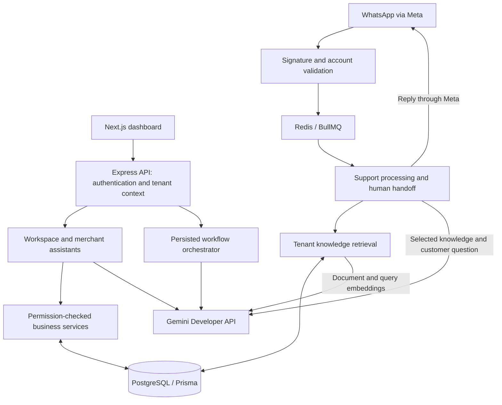

# Project Summary & Architecture Notes

**Project:** AI Workforce — Autonomous Operations Team
**Focus:** Gemini API integration and application architecture
**Reviewed:** 17 October 2026 · Current repository implementation

## Project Summary

AI Workforce is a multi-tenant business platform that combines customer support, merchant assistance, and configurable operational workflows. Businesses manage their workspace through a web dashboard and connect channels such as WhatsApp and commerce systems. Gemini provides language generation, semantic embeddings, and constrained interpretation of natural-language requests. Application services handle authentication, tenant boundaries, business-data retrieval, workflow execution, and human approval. This architecture places model capabilities within explicit business processes while keeping operational facts and execution controls in the backend.

## Architecture Overview

The application uses a Next.js/TypeScript frontend, an Express/TypeScript API, PostgreSQL through Prisma, Redis/BullMQ for inbound support jobs, and Socket.io for dashboard updates. Gemini calls execute server-side through Google's `@google/genai` JavaScript/TypeScript SDK. The implemented client uses API-key initialization, consistent with the [Gemini Developer API integration pattern](https://googleapis.github.io/js-genai/release_docs/index.html).

## How Gemini Is Integrated

The [Gemini service](../apps/api/src/services/geminiService.ts) initializes `GoogleGenAI` using `GEMINI_API_KEY`. Generation and embedding models are selected through `GEMINI_MODEL` and `GEMINI_EMBEDDING_MODEL` in the [server configuration](../apps/api/src/config/env.ts).

| Capability | Data sent to Gemini | Application handling |
| --- | --- | --- |
| Grounded support responses | Customer question, retrieved business text, and support instructions | `generateContent` produces a reply when retrieval context is available; FAQ and fallback paths also exist. |
| Knowledge embeddings | Document chunks or a retrieval query, with the corresponding retrieval task type | `embedContent` requests 768-dimensional vectors for semantic matching. |
| Workflow agent tasks | Selected JSON context and an agent system prompt | Generated text becomes a recorded workflow-node result. Separate nodes handle actions and approvals. |
| Workspace assistant | Question and workspace name | A constrained intent is validated with Zod; a backend formatter supplies the metric values. |
| Merchant assistant | Merchant question, including supported Roman Urdu phrasing | Validated intent/search text routes to permission-checked commerce services. Returned business facts come from those services. |

The classification paths use JSON Schema constraints and local validation. Support and workflow generation return free text. These are distinct output contracts, consistent with Google's [structured-output documentation](https://ai.google.dev/gemini-api/docs/structured-output).

## Representative Support Flow

For messages entering the general support path, the webhook validates the Meta signature and workspace phone-number association, then awaits durable queue acceptance. The worker stores conversation context and checks whether automated support is eligible. Eligible requests use verified commerce lookups, FAQ matching, or tenant knowledge retrieval. With suitable retrieved context and a configured key, Gemini generates a support response. The backend sends the reply through Meta and records the result; escalation policies can pause automation and route the conversation to staff. See the [webhook](../apps/api/src/controllers/webhookController.ts) and [support processor](../apps/api/src/services/supportAgentService.ts).

## Retrieval, Controls, and Reliability

The [retrieval service](../apps/api/src/services/ragService.ts) stores embeddings as serialized vectors and scores up to 50 recent tenant-filtered chunks in application code. It uses cosine similarity when embeddings are available and lexical matching otherwise. This implementation uses Gemini [embeddings](https://ai.google.dev/gemini-api/docs/embeddings); it does not establish an indexed database vector-search pipeline.

API credentials remain server-side. Selected questions, knowledge text, and workflow context cross the Gemini API boundary. Support prompts restrict answers to supplied context and use low temperature; these controls do not guarantee factual correctness. Generation failure can fall back to retrieved text, while missing knowledge can trigger human escalation. Classification calls have explicit timeouts; timeout and fallback behavior vary by path. The [workflow orchestrator](../apps/api/src/services/orchestratorService.ts) separates generation, tool execution, and approval nodes. Queue failures return retryable webhook errors.

## Google Technology Scope and Verification

Gemini requests use API-key authentication. The [Cloud Run deployment setup](CLOUD_RUN_DEPLOYMENT.md) defines Cloud Build, Artifact Registry, Secret Manager bindings, and separate service identities; live GCP deployment remains unverified. Vertex AI mode, IAM-authenticated Gemini requests, and managed vector search are not implemented. Google Calendar is a separate Google API connector. Model availability and live provider behavior require deployment verification.

Existing [workspace-assistant tests](../apps/api/tests/workforceMetrics.test.ts) and [merchant-assistant tests](../apps/api/tests/merchantQuestion.test.ts) cover selected validation and factual-routing behavior using mocks. This document reflects source review; no new live inference or production acceptance run was performed for its preparation.
